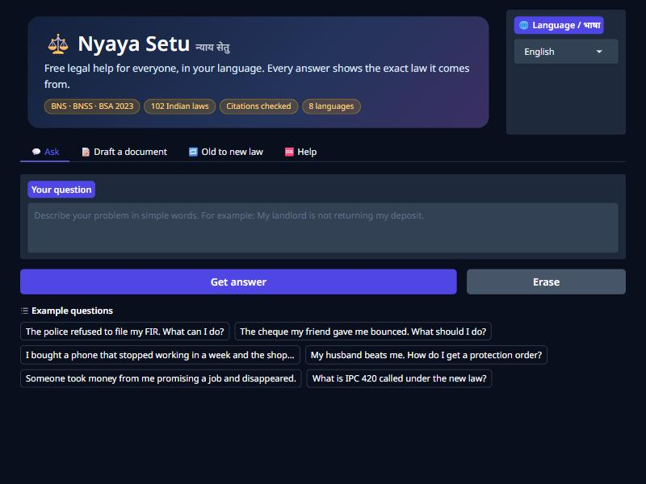
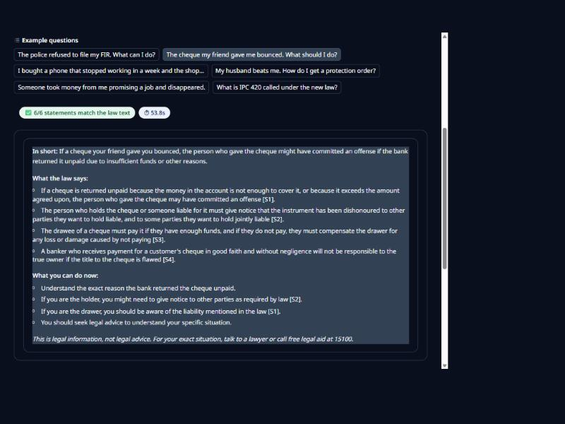
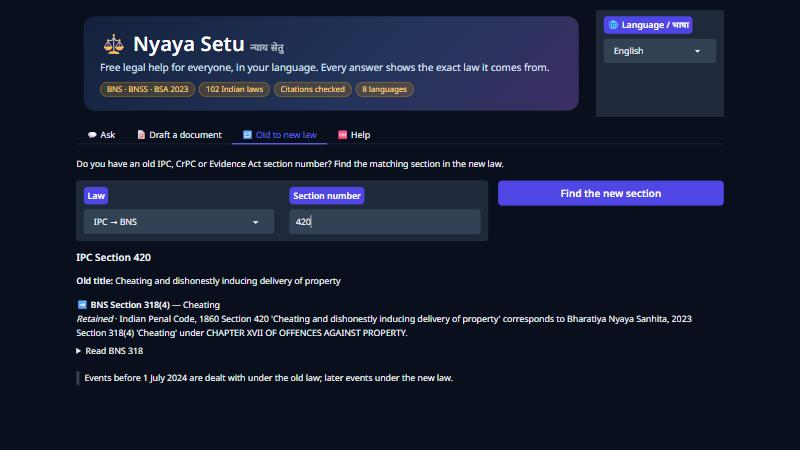

# ⚖️ Nyaya Setu — Free Legal Help for Everyone in India, With Checked Citations

<p align="left">
  <a href="https://github.com/kkm121/Nyaya-setu-multi-lang"></a>
  <a href="https://huggingface.co/spaces/kkm121/NyayaSetu"></a>
  
  
  
  
  
  
</p>

> **Live app**: [huggingface.co/spaces/kkm121/NyayaSetu](https://huggingface.co/spaces/kkm121/NyayaSetu)
>
> **Repository**: [github.com/kkm121/Nyaya-setu-multi-lang](https://github.com/kkm121/Nyaya-setu-multi-lang)

**Nyaya Setu** ("bridge to justice") helps ordinary people understand a legal problem and what to do next, in their
own language. It searches the text of **102 Indian laws**, writes an answer **only** from the sections it finds, and
then **checks every statement** against those sections before showing it. If the law it found does not support an
answer, it says so instead of guessing. It can also **draft documents**: a police complaint, a reply to a legal notice,
a cheque-bounce notice, a consumer complaint, an RTI application or a deposit-refund notice.

Why this matters: Stanford researchers found that leading commercial legal AI tools still gave wrong or
unsupported answers in **17–34%** of test queries ([Magesh et al., 2024/25](https://hai.stanford.edu/news/ai-trial-legal-models-hallucinate-1-out-6-queries)).
And India replaced the IPC, CrPC and Evidence Act with the **BNS, BNSS and BSA on 1 July 2024**, so any model trained
only on the old codes now gives outdated section numbers. Nyaya Setu v2 is built around both problems.

---

## Table of Contents

- [1. What Changed From v1](#1-what-changed-from-v1)
- [2. Repository Structure](#2-repository-structure)
- [3. Interface Showcase](#3-interface-showcase)
- [4. How an Answer Is Made](#4-how-an-answer-is-made)
- [5. How Hallucinations Are Blocked](#5-how-hallucinations-are-blocked)
- [6. Languages](#6-languages)
- [7. Document Drafting](#7-document-drafting)
- [8. Data Sources](#8-data-sources)
- [9. Fine-Tuning on Kaggle](#9-fine-tuning-on-kaggle)
- [10. Evaluation Results](#10-evaluation-results)
- [11. Local Development and Verification](#11-local-development-and-verification)
- [12. Deploying to the Hugging Face Space](#12-deploying-to-the-hugging-face-space)
- [13. Design Decisions](#13-design-decisions)
- [14. Limitations](#14-limitations)

---

## 1. What Changed From v1

| | v1 (Nyaya-Tuned) | v2 (Nyaya Setu) |
| :--- | :--- | :--- |
| Law covered | IPC, CrPC, Constitution (old law) | 102 acts: BNS, BNSS, BSA, IPC, CrPC, IEA, Constitution, NI Act, Consumer Protection, RTI, DV Act and more |
| Old → new law | Not handled | 2,629 official IPC↔BNS, CrPC↔BNSS, IEA↔BSA mappings; date-aware (before / after 1 July 2024) |
| How answers are made | Fine-tuned model answers from memory | Hybrid search (BM25 + multilingual embeddings) finds the law first; the model answers only from it |
| Citations | None | Every legal sentence cites `[S1]…`, and is machine-checked |
| When unsure | Answers anyway | Says "not sure", shows related sections, points to free legal aid (15100) |
| Translation | Google scrape, fails silently | Legal terms locked, back-translation quality check, offline fallback model |
| Documents | — | 6 document templates, Word and PDF download, nothing invented |
| Runs on | 8 GB GPU | Free CPU Space (GGUF via llama.cpp) |
| Tests / eval | — | 96 unit tests + frozen 79-question evaluation set (+ 20 hand-written Hindi questions) |

---

## 2. Repository Structure

```
Nyaya-setu-multi-lang/
├── app.py                      # Gradio web app: Ask · Draft · Old→New · Help
├── nyaya/
│   ├── acts.py                 # 102 act names, groups, old→new pairs
│   ├── corpus.py               # Raw sections → clean, searchable chunks + mapping table
│   ├── query.py                # Finds section numbers, act names and dates in a question
│   ├── retrieve.py             # BM25 + e5 embeddings, RRF merge, exact lookup, mapping expansion
│   ├── prompts.py              # Strict grounded prompts ([S1] sources, NOT_IN_SOURCES rule)
│   ├── llm.py                  # llama.cpp (CPU) · HF Inference API · extractive (no model)
│   ├── verify.py               # Citation, section-number, number and support checks
│   ├── translate.py            # Locked legal terms, Google + local NLLB/IndicTrans2 fallback
│   ├── drafting.py             # 6 legal document templates → Markdown / DOCX / PDF
│   ├── pipeline.py             # question → search → answer → check → translate
│   ├── ui_text.py              # Interface text (EN) + loader for translations
│   └── ui_text.json            # Machine-translated interface text with quality scores
├── data/
│   ├── corpus/chunks.jsonl     # 16,379 law chunks (built by nyaya/corpus.py)
│   ├── corpus/mapping.json     # Old ↔ new section mapping
│   └── index/embeddings.npy    # Precomputed e5 embeddings (float16)
├── eval/
│   ├── questions.jsonl         # Frozen set: 64 answerable + 15 unanswerable questions
│   ├── questions_hi_native.jsonl # 20 questions written directly in Hindi
│   └── run_eval.py             # Retrieval, end-to-end and multilingual evaluation
├── training/
│   ├── build_sft_data.py       # Grounded, cited training examples (+ abstain examples)
│   └── kaggle/train_nyaya.py   # Gemma 4 QLoRA on Kaggle GPU → merged GGUF
├── scripts/
│   ├── download_data.py        # Fetches the raw law data
│   ├── build_ui_text.py        # Translates interface text, scores each line
│   └── build_space.py          # Packages and (optionally) pushes the HF Space
├── tests/test_core.py          # pytest suite (no internet or model needed)
├── legacy_v1/                  # The original v1 code, kept for reference
└── PROJECT_CONTROL.md          # Rules, checklist and decision log for this project
```

---

## 3. Interface Showcase

Captured from the app running locally (base Gemma 4 E2B on CPU, dark theme):

| **Home** | **A checked answer** |
|:---:|:---:|
|  |  |
| *Ask in any of 8 languages; one-click example questions.* | *"6/6 statements match the law text": every claim is tied to an NI Act section.* |

| **Old → New law** |
|:---:|
|  |
| *IPC 420 → BNS 318(4), with the official concordance note and the 1 July 2024 rule.* |

---

## 4. How an Answer Is Made

```
Question (any of 8 languages)
  │ 1. translate to English, with section numbers and act names locked
  ▼
Query understanding ── "IPC 420", "Section 138 NI Act", "Article 21", dates (before/after 1 July 2024)
  │ 2. exact section lookup + old↔new mapping
  │ 3. BM25 keyword search + multilingual-e5 meaning search, merged with Reciprocal Rank Fusion
  ▼
Top 5 sections, labelled [S1]..[S5]
  │ 4. Gemma 4 writes an answer using ONLY these sections
  ▼
Checker ── removes unknown sections, fake tags, unsupported numbers; abstains if support is weak
  │ 5. translate back to the user's language, check quality, show English too if needed
  ▼
Answer + "✅ 4/4 statements checked" + the full law text of every cited section
```

| Step | File | What it does |
| :--- | :--- | :--- |
| Section finder | `nyaya/query.py` | Regex for "section 302 IPC", "u/s 498A", "IPC 420", "Article 21", "धारा 302"; act aliases ("cheque bounced" → NI Act) |
| Exact lookup | `nyaya/retrieve.py:lookup` | Named sections always come first, with their old/new counterparts |
| Lay-term glossary | `nyaya/query.py:LAY_TERMS` | 34 everyday phrases → legal wording ("stole" → theft, "FIR" → information in cognizable cases); added to the search, never shown as law |
| Hybrid search | `nyaya/retrieve.py:search` | BM25 (inverted index) top-60 + e5 passages top-60 + e5 section titles top-60 → RRF (k=60); boosts named acts; old law down-weighted unless the event is before 1 July 2024 |
| Rerank | `nyaya/retrieve.py` | Multilingual cross-encoder (mMiniLM, mMARCO) re-orders the top 20; its best score is the confidence signal |
| Answer | `nyaya/prompts.py` | Fixed format: **In short** · **What the law says** (cited) · **What you can do now** |
| Check | `nyaya/verify.py` | See section 5 |

---

## 5. How Hallucinations Are Blocked

These rules are **enforced in code**, not just requested in the prompt:

| Check | Rule | Result if broken |
| :--- | :--- | :--- |
| Cite or drop | Each sentence stating law must carry a valid `[S#]` | Fake tags removed; uncited legal claims with numbers or sections removed |
| Section check | Every "Section N" / "Article N" must be among the retrieved sections or the official mapping | Sentence removed |
| Number check | Every number ("7 years", "30 days", "twice the amount") must appear in the cited source | Flagged ⚠️ as unverified |
| Support check | ≥30% of a sentence's meaningful words must appear in its cited section | Flagged ⚠️ as unverified |
| Abstain | Low search confidence, `NOT_IN_SOURCES`, or under half the claims supported | "Not sure" answer + related sections + legal aid 15100 |
| Drafts | Names and numbers in a polished draft must come from the user's own facts | The user's original text is used instead |

The fine-tuned model is also trained to answer `NOT_IN_SOURCES` when the right section is missing (about 10% of
training examples hide the correct section on purpose).

---

## 6. Languages

**Phase 1 (current):** English, हिन्दी Hindi, தமிழ் Tamil, తెలుగు Telugu, ಕನ್ನಡ Kannada, বাংলা Bengali, मराठी Marathi, ગુજરાતી Gujarati.
**Phase 2 (planned, after phase 1 passes):** Malayalam, Punjabi, Odia, Urdu. The code already supports them (`EXTRA_LANGUAGES`).

- **Locked terms:** `[S1]` tags, act names (BNS, BNSS, IPC, FIR…), "Section 318(4)", `[TO FILL]` and the 15100
  helpline are swapped for placeholders before translation and restored after, so they cannot be mistranslated.
  Tested in all 8 languages: every locked item came back unchanged.
- **Quality check:** each translated answer is translated back to English and compared with the original
  (multilingual-e5 similarity). If the score is low, the English answer is shown beside it.
- **Engines:** Google (fast) → local NLLB-200 (offline, never rate-limited), with a 10-minute circuit breaker when
  Google fails. IndicTrans2 (AI4Bharat, MIT licence) is supported via `NYAYA_MT_MODEL` once its gated terms are accepted.

**How the interface text was made**

| Language | Interface text | Reviewed by |
| :--- | :--- | :--- |
| English | Written by hand, in plain words that translate well | — |
| हिन्दी Hindi | Written by hand | Reviewed line by line (`nyaya/ui_text.py: REVIEWED`) |
| Tamil, Telugu, Kannada, Bengali, Marathi, Gujarati | Machine translated (NLLB-200), locked terms protected | **Not yet reviewed by a native speaker** — contributions welcome |

Why hand review matters: an early machine translation turned "The law this answer is based on" into Hindi meaning
"The law is based on this answer", and used *virodh* ("opposing") for "checked against". Back-translation word
overlap still scored that line 1.00, so automatic checks alone cannot certify a translation. The English source text
was then rewritten without idioms, which fixed the same error in Marathi, Bengali, Gujarati and Kannada.

**Translator comparison** (`python -m eval.compare_mt`, results in `eval/results_mt_compare.json`)

| | IndicTrans2 (dist-200M) | NLLB-200 (600M) |
| :--- | :---: | :---: |
| 20 hand-written Hindi questions → English → right law in top 5 | **0.90** | 0.80 |
| Meaning kept, 8 legal answers × 7 languages (multilingual-e5 similarity to the English) | 0.941 | 0.941 |
| Locked terms intact (all 7 languages) | 56 / 56 | 56 / 56 |
| Seconds per answer (CPU) | **~2.3** | ~4.4 |

IndicTrans2 is the default when the Hugging Face token can download it (it is gated); otherwise NLLB is used.
Before two fixes, both translators lost terms (Bengali kept them in only 2 of 8 answers): models sometimes spelled the
placeholders in local script, or dropped the `[S1]` tag at the end of a sentence. End-of-sentence tags now skip the
model entirely, and spelled-out placeholders are recognised and restored.

<!-- LANGUAGE RESULTS -->

---

## 7. Document Drafting

Six documents, each in the standard Indian format (checked against common published formats: iPleaders,
Jurigram, Vakeel360, Advocate Gandhi, Vikaspedia RTI):

| Document | Format and legal basis printed (every quoted provision is checked against the statute text in tests) |
| :--- | :--- |
| Police complaint (FIR request) | To the SHO · subject citing BNSS s.173 · numbered first-person facts · accused, witnesses, evidence · request incl. free copy under s.173(2) · declaration · enclosures |
| Reply to a legal notice | Regd. A.D./Speed Post · title · Ref · "I, …, S/o …, aged about …, residing at …" · denial clause · numbered "That …" paragraphs · demand with time limit · without-prejudice reservation · copy retained · Place/Date |
| Cheque bounce notice | Same notice layout · cheque details · amount in figures **and words** (Indian lakh/crore) · NI Act s.138 / s.142 · 15-day demand |
| Consumer complaint | Court caption · Complainant vs Opposite Party · "COMPLAINT UNDER SECTION 35 …" · MOST RESPECTFULLY SHOWETH · limitation (s.69) · jurisdiction (s.34) · PRAYER · VERIFICATION |
| RTI application | To the CPIO/SPIO · numbered particulars and questions · mode · fee or BPL (s.7(5) proviso) · citizenship (s.3) · no reason needed (s.6(2)) |
| Rent deposit refund notice | Notice layout · tenancy, deposit, vacating · agreed deduction · optional interest · time limit |

**Nothing is typed freely where a fixed answer exists.** "What do you want them to do" is a set of standard reliefs,
dates use a calendar, relations (S/o, D/o, W/o, C/o) and reasons are drop-downs. Every field is checked first
(`nyaya/forms.py`):

| Field | Rule |
| :--- | :--- |
| Names | Letters of any Indian script (vowel signs included), at least 3 letters, no digits or symbols, no keyboard mash ("asd", "jk", "sdfgh") |
| Addresses | Full address with a valid 6-digit PIN code |
| Dates | Real calendar dates, not in the future, and in a sensible order (notice received after it was dated, cheque before return memo, etc.) |
| Amounts, cheque no., phone, email | Numbers only and in range · exactly 6 digits · Indian mobile (6-9 + 9 digits) · valid email |
| Facts | At least 2–3 real sentences; HTML and control characters removed; gibberish refused |
| Section 138 | A notice more than 30 days after the bank memo is **refused** with an explanation (the law requires 30 days) |
| Forged options | Values that are not one of the offered choices are rejected |

Errors are listed in the person's language, and no file is produced until everything is valid.

**Languages.** The English copy is the one to sign. A second copy in the person's language (Word + PDF) can be
added: fixed letter words ("To,", "Yours faithfully,", "Subject:" …) come from a hand-written list for all 7
languages, and act names, institutions, "dishonour", S/o/D/o/W/o and everything the person typed stay exactly as
written. If the facts were typed in an Indian language, the translated copy uses the person's own words. PDFs use
Noto fonts merged per script (`scripts/build_fonts.py`), so Indian-script and English text render correctly on the
same line.

**Bugs found while testing this, now fixed and covered by tests:** real Tamil and Hindi names were rejected (vowel
signs were not counted as letters); PIN codes like 600008 were taken for keyboard mash; machine translation turned
the "Negotiable Instruments Act" into the "Illegal Instructions Act", "dishonour" into "insult" and "Ref. No." into
"no"; English lines next to Indian-script lines vanished from PDFs (a font-fallback bug); a paragraph number could
be stranded at a page break.

## 8. Data Sources

| Source | Content | Licence | How it was checked |
| :--- | :--- | :--- | :--- |
| [GSMS-B/indian-legal-knowledge-base-json](https://huggingface.co/datasets/GSMS-B/indian-legal-knowledge-base-json) | 12,174 sections of 102 central acts (India Code / Gazette), 6 old↔new mapping tables | CC BY 4.0 | 8 section texts and 11 mappings spot-checked (e.g. IPC 302→BNS 103, 420→318(4), CrPC 438→BNSS 482, 124A deleted) |
| [GSMS-B/Indian-Legal-QA-BNS-BNSS-BSA](https://huggingface.co/datasets/GSMS-B/Indian-Legal-QA-BNS-BNSS-BSA) | 6,354 scenario Q&A on BNS/BNSS/BSA | Apache 2.0 | Training only; each answer kept only if it overlaps its section text and all its numbers appear in the section |
| `data/ipc_dataset.json` (v1) | 27,050 Constitution / IPC Q&A | — | Kept for reference; not used in v2 training (old law) |

Full verification log: [`PROJECT_CONTROL.md`](PROJECT_CONTROL.md) section 6.

---

## 9. Fine-Tuning on Kaggle

QLoRA on **Gemma 4 E2B-it** (`google/gemma-4-E2B-it`), trained on a free Kaggle **Tesla T4** (fp16), with
`training/kaggle/train_nyaya.py`. The merge and GGUF export run separately on CPU (`training/kaggle/merge_nyaya.py`).

**Training data** (`training/build_sft_data.py` → 8,158 examples, each in the exact prompt format the app uses):

| Part | Examples | How it was made |
| :--- | ---: | :--- |
| BNS / BNSS / BSA Q&A | 4,081 | GSMS-B Q&A; kept only if the answer overlaps its section text and every number appears in it (2,273 dropped) |
| v1 Constitution / IPC Q&A | 3,060 | Kept only if search finds a section that supports ≥50% of the answer (2,841 dropped) |
| Old → new mapping | 603 | From the official concordance tables |
| "NOT_IN_SOURCES" | 414 | The correct section is hidden on purpose; the model must decline |
| Removed as too close to eval questions | 109 | Token overlap > 0.6 with any frozen eval question |

**Run** (2026-11-07): LoRA r=16, α=32 on the 205 language-model projection layers only (vision and audio towers
untouched), lr 2e-4 cosine, effective batch 16, 1 epoch = 498 steps, max 1,536 tokens, loss on answer tokens only.

| | Value |
| :--- | :--- |
| Validation loss | 3.32 → 0.30 (lowest 0.27 at step 400) |
| Time | 4.7 h on one T4 |
| Peak GPU memory | 8.3 GB |
| Adapter | 96.7 MB, 24.2 M trainable parameters (0.47%) |

Four Kaggle runs were needed; the fixes are recorded in `PROJECT_CONTROL.md` (bf16 on T4, `prepare_model_for_kbit_training`
casting Gemma 4's per-layer embeddings to fp32, logits only on answer tokens because of the 262k vocabulary).

**Ship rule (fixed before training):** the fine-tuned model is used only if, on the frozen eval set, it cites the correct
law more often than the base model without more unsupported claims. Otherwise the app keeps the base model.

<!-- TRAINING RESULTS -->

---

## 10. Evaluation Results

All numbers below come from `python -m eval.run_eval` on the frozen set in `eval/questions.jsonl`:
**64 answerable** plain-language questions (each with the correct section(s), every one checked to exist in the corpus)
and **15 unanswerable** ones (GST rates, court dates, recipes…). Training data excludes anything too close to these questions.

### Retrieval (is the right law in the top 5?)

| Setup | Recall@5 | MRR | "Not sure" on unanswerable | Wrong "not sure" on answerable |
| :--- | :---: | :---: | :---: | :---: |
| BM25 + e5 passages (baseline) | 0.609 | 0.424 | — | — |
| + e5 section-title index | 0.734 | 0.470 | — | — |
| + multilingual reranker | 0.797 | 0.659 | 5 / 15 | 5 / 64 |
| + lay-term glossary (**app default**) | **0.891** | **0.727** | 5 / 15 | 3 / 64 |

Honesty notes: the glossary was written *after* seeing which questions failed, so 0.891 is optimistic; 0.797 is the
conservative figure for unseen phrasing. The "not sure" threshold (reranker score −5) was fixed *before* the 10 extra
unanswerable questions were added. Retrieval alone catches only a third of unanswerable questions; the rest are left
to the model (`NOT_IN_SOURCES`) and the checker, measured below.

### Full answers (`--e2e`, 35 answerable + 15 unanswerable questions, CPU)

| Model | Cites the correct law | Wrong "not sure" | Declines unanswerable | Statements that match their cited law | Removed by checker | Avg time |
| :--- | :---: | :---: | :---: | :---: | :---: | :---: |
| Gemma 4 E2B (base, Q4_K_M) | 28 / 35 | 2 / 35 | 10 / 15 | 96.4% | 12 | 37.9 s |

| Gemma 4 E2B + Nyaya Setu QLoRA (Q4_K_M) | 22 / 35 | 8 / 35 | **15 / 15** | 89.5% | 8 | **20.2 s** |

**Decision: the app ships the base model.** The fine-tuned model declines every unanswerable question and is almost
twice as fast, but it also says "not sure" on 8 answerable questions and cites the correct law less often. The ship
rule was fixed before training, so it is applied as written. Likely cause: short training answers plus the 414
`NOT_IN_SOURCES` examples taught it to be too cautious. Next attempt: fewer abstain examples and longer, fuller answers.
The fine-tuned GGUF can still be tried with `NYAYA_LLM_PATH`.

What the misses look like: for "stamp duty in Mumbai" and "court fee in Karnataka" (state rules, not in the corpus)
the model answered from related central acts instead of declining. Every sentence it kept was checked against a real
section, but the answer did not address the actual question. State laws are listed under Limitations.

<!-- E2E RESULTS -->

---

## 11. Local Development and Verification

### Prerequisites

- Python 3.11, about 8 GB free RAM, 6 GB disk (model + index). No GPU needed.

### Setup

```bash
git clone https://github.com/kkm121/Nyaya-setu-multi-lang.git
cd Nyaya-setu-multi-lang
python -m venv .venv && .venv\Scripts\activate      # Linux/macOS: source .venv/bin/activate
pip install -r requirements.txt
python -m scripts.download_data                     # raw law data → data/raw/
python -m nyaya.corpus                              # → data/corpus/ (16,379 chunks)
python app.py                                       # http://127.0.0.1:7860
```

The first start builds the embedding index (about 45 minutes on a desktop CPU) unless `data/index/` is present,
and downloads the Gemma 4 E2B GGUF (3.1 GB).

| Setting (env var) | Default | Meaning |
| :--- | :--- | :--- |
| `NYAYA_BACKEND` | `llamacpp` | `llamacpp`, `api` (needs `HF_TOKEN`), or `extractive` (no model) |
| `NYAYA_LLM_REPO` / `NYAYA_LLM_FILE` | `unsloth/gemma-4-E2B-it-GGUF` / `gemma-4-E2B-it-Q4_K_M.gguf` | GGUF to load |
| `NYAYA_LLM_PATH` | — | Use a local GGUF file instead |
| `NYAYA_MT` | `auto` | `auto` (Google, then local), `google`, `local` |
| `NYAYA_MT_MODEL` | `facebook/nllb-200-distilled-600M` | Local translator (e.g. an IndicTrans2 model) |
| `NYAYA_RERANK` | `1` | `0` turns off the multilingual cross-encoder reranker |
| `NYAYA_LOW_CONF` | `0.375` | Confidence below which the app says "not sure" (reranker score −5) |

### Tests

```bash
python -m pytest tests -q
```

Verified output (Windows, Python 3.11, `.venv3` with transformers 4.46.3): **95 passed**. The suite covers the corpus
(key sections and mapping pairs), section-reference parsing, spelling normalisation, the citation checker (unknown
sections, fake tags, wrong numbers, uncited claims, abstain), translation locking (including repair of placeholders a
model spelled in local script, and end-of-sentence tags), every document template (Markdown, Word and PDF), the
draft guard against invented names and numbers, and interface-text coverage.

### Evaluation

```bash
python -m eval.run_eval                                   # retrieval, English
python -m eval.run_eval --langs hi,ta,te,kn,bn,mr,gu      # retrieval, 7 Indian languages
python -m eval.run_eval --e2e --backend llamacpp          # full answers with the model
```

---

## 12. Deploying to the Hugging Face Space

```bash
python -m scripts.build_space            # builds space_build/ (code + corpus + index + Space README)
python -m scripts.build_space --push     # uploads to the SAME Space, so the shared link never changes
```

The Space README uses `preload_from_hub` so the model files are downloaded at build time, not on the first visit.

---

## 13. Design Decisions

- **Retrieve first, then answer.** Fine-tuning alone memorises law imperfectly, and the law changed in 2024. Search over
  the actual statute text, with the model limited to what was found, is the approach with the best evidence.
- **Checks in code, not just in the prompt.** Small models do not always follow instructions; the checker does.
- **Abstaining is a feature.** For someone facing the police, "I am not sure, call 15100" is better than a confident mistake.
- **Same Space, same link.** Updates are pushed to `kkm121/NyayaSetu` so everyone you shared it with keeps access.
- **No "Stop Server" button.** v1 had one; on a public Space any visitor could have shut the app down for everyone.
- **CPU-first.** Gemma 4 E2B in 4-bit GGUF runs on the free 2-vCPU Space; heavy training happens on Kaggle.
- **Exact law text.** The corpus is never "cleaned" in ways that change wording; an early attempt to remove repeated lines
  was reverted after it deleted legitimately repeated provisos (see the decision log).

---

## 14. Limitations

- Central acts only. State laws (rent control, stamp duty, police acts) and court judgments are not included yet.
- Translation quality differs by language; the app shows the English answer when its own quality check is weak.
- Rules made under acts (fees, forms, pecuniary limits) are not in the corpus, so the app does not quote them.
- This is legal information, not legal advice. For your situation, talk to a lawyer or call **15100** (NALSA).

---

<p align="center">
  <b>⚖️ Nyaya Setu</b> — legal help for everyone, in their own language<br>
  <a href="https://github.com/kkm121/Nyaya-setu-multi-lang">GitHub</a> · <a href="https://huggingface.co/spaces/kkm121/NyayaSetu">Live app</a>
</p>
